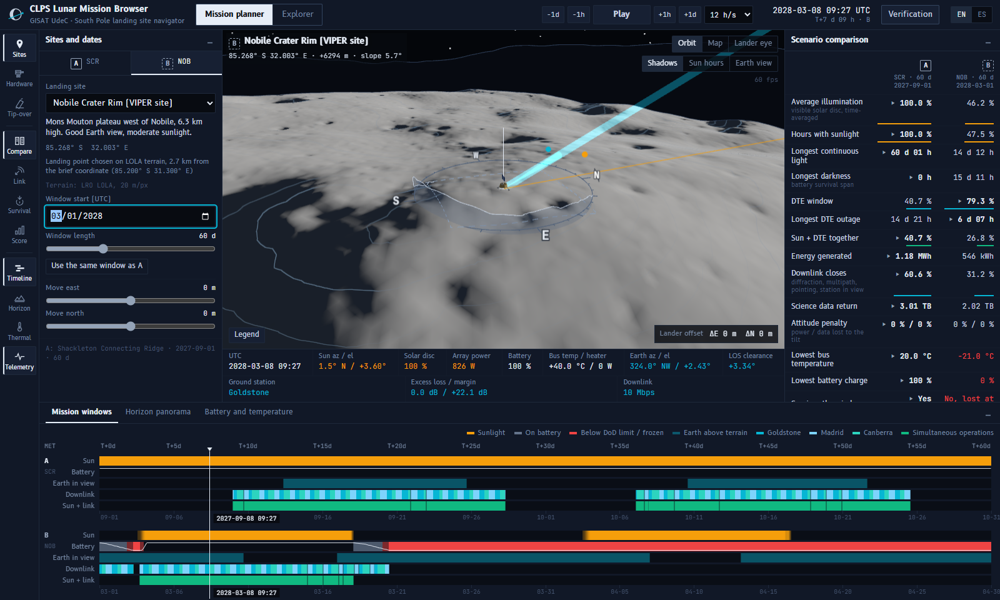

# CLPS Lunar Mission Browser v3.0

## Quick Start (clonar y ejecutar en 1 minuto)

Requiere [Node.js](https://nodejs.org) 20 o superior. Funciona igual en Windows, macOS y Linux, sin `.env` ni descargas extra: el terreno LOLA, las capas científicas, las imágenes y las guías vienen en el repositorio.

```bash
git clone https://github.com/JoseVenegas3/Lunar-Landing-Site-Navigator.git
cd Lunar-Landing-Site-Navigator
npm install
npm run dev
```

Abre la dirección que imprime Vite (<http://localhost:5173>). Para la versión de producción: `npm run build && npm run preview` (<http://localhost:4173>). Funciona sin conexión a internet; solo las coordenadas libres usan, si hay red, la fuente de 20 m de NASA (sin red se quedan en 160 m y la app lo dice). `.env.example` es opcional y solo sirve para un despliegue estático.


Navegador de sitios de alunizaje del Polo Sur lunar. GISAT UdeC, NASA Space
Apps Challenge 2026.

Compara sitios candidatos y rangos de fechas mostrando dónde están el Sol y la
Tierra respecto del horizonte topográfico local, y qué significa eso para la
energía y para el enlace directo a la Tierra (DTE).



Al abrirla, una puerta pregunta si ya la usaste. **Principiante** es un
entrenamiento guiado de ocho misiones, con narración, sonido y consolas que se
desbloquean una a una. **Mission Leader** es la consola completa (la interfaz
v2.1). Para saltar la puerta: `?mode=leader` o `?mode=beginner`.

## Presentación

Para el pitch de la hackathon hay una presentación de 7 diapositivas con capturas reales de la app y notas del orador ([docs/pitch-gisat-lunar-navigator.pptx](docs/pitch-gisat-lunar-navigator.pptx)) y una grabación de 3 minutos de la app ([docs/video/gisat-lunar-navigator-3min.mp4](docs/video/gisat-lunar-navigator-3min.mp4)). Ninguna forma parte de la app.

**Presentación animada para el escenario** (3D en vivo, sin conexión): `npm run pitch-deck` abre <http://localhost:5175/pitch-deck/>. Siete actos con la Luna real (mapas LRO) y un módulo 3D que se inclina, se congela y se rescata. Teclas: → / Espacio avanzar, ← volver, N notas del orador con indicaciones escénicas, T reinicia el cronómetro de 3:00, F pantalla completa. Para el envío oficial están las versiones PowerPoint de 7 diapositivas en inglés y español (`node scripts/build-pitch-pptx.mjs`).

## Cómo ejecutarlo

Ver **Quick Start** arriba. En Windows también vale doble clic en
`run-dev.cmd`. Node.js en Windows: `winget install OpenJS.NodeJS.LTS`.

## Qué hace

- **Efemérides reales** del Sol y la Tierra desde cualquier punto entre 80° S y
  90° S, de 2026 a 2030, en ventanas de 1 a 180 días con paso horario. Validadas
  contra NASA/JPL Horizons (error máximo 0,0023°). Sin conexión a servicios
  externos.
- **Cinco sitios candidatos**, seis regiones candidatas de Artemis III/IV,
  otras misiones notables (VIPER / Griffin, Chang'e 7, ILRS, IM-1) y el
  alunizaje de IM-2, más coordenadas personalizadas y micro-relocalización de
  ±500 m, arrastrando el lander en la vista 3D.
- **Horizonte de 360°** por sitio, fracción visible del disco solar y línea de
  vista DTE con margen de antena.
- **Presupuesto de energía** (tres monturas de panel, batería, alerta de
  profundidad de descarga y de congelamiento) y **presupuesto de enlace** en
  banda X o S con tres estaciones terrenas.
- **Satélites de retransmisión**: constelaciones de 1 a 8 relays en órbita lunar
  (elíptica congelada, polar baja o personalizada) y cuánto cierran los cortes
  del enlace directo en cada sitio.
- **Contingencia y supervivencia**: actitud de alunizaje con presets IM-1, IM-2 y
  SLIM; enlace con difracción, multipath y relevo de estaciones DSN; modelo
  térmico acoplado con calefactores y congelación de batería; índice
  multicriterio; malla de dispersión con vector de escape; activo vecino con
  sombra mutua y eyección por pluma.
- **Exportar CSV** con un clic: telemetría simulada en 26 columnas, siempre en
  SI (la cabecera lo declara), una fila por hora.
- **Unidades SI / Imperial** (v3.1), elevación solar como KPI de potencia,
  telémetro del cursor más allá de ±500 m, ventana «Aprender más: Física
  Lunar vs. Tierra», límites declarados de LOLA, contraste con mapas de
  iluminación publicados, glosario con tooltips y búsqueda de rescate en un
  Web Worker.
- **Dos modos**: Planificador (un escenario de alunizaje, con comparación A/B
  a demanda dentro de Ventanas de aterrizaje, y fichas de los sitios
  candidatos) y **Emergencia** (posición y energía disponible, evaluado desde
  ahora durante una noche lunar: titular SOBREVIVE / SOBREVIVE SI… / NO
  SOBREVIVE y bloque **Salida** con las opciones calculadas). El modo
  Explorador de la v2.0 se retiró en la v2.1.
- **Veredicto GO / CAUTION / NO-GO** en lenguaje llano sobre la vista 3D, con
  rescate de un clic (mejor punto a 200 m o siguiente fecha viable) y su antes
  y después.
- **Consola por subsistemas**: cinco pestañas a todo el ancho (Resumen,
  Energía/térmico, Comunicaciones/RF, Terreno/alunizaje y Ciencia) con una
  transición negro → ícono → consola. Cada una trae sus paneles, su color, su
  capa sobre el terreno y lo que destaca la escena 3D. Los paneles son bandejas
  de cristal que flotan sobre la vista sin redimensionarla. Ciencia incluye la
  Vista de ingeniería (tabla KPI completa, línea de tiempo detallada y tabla
  **Supuestos del modelo** con el origen de cada umbral).
- **Control de tiempo en la vista 3D** (−1 h, reproducir, +1 h; 1, 24 o 72 h/s)
  y doble clic en el terreno para mover el lander o crear un sitio, con un
  retículo que dice qué ocurrirá.
- **Modo tutorial** («Guía de misión»): una secuencia de diez pasos que conduce
  la interfaz y al terminar devuelve el estado previo. **Guía (PDF)** completa
  en español e inglés.
- **Terreno de 20 m en cualquier punto entre 80° S y 90° S**: se lee bajo
  demanda del mosaico LOLA con peticiones HTTP Range y queda guardado en
  IndexedDB. Requiere el proxy incluido en `npm run dev` / `npm run preview`
  (el servidor de NASA no permite CORS) o un espejo en `VITE_LOLA_COG_URL`.
- Interfaz en inglés y español.

**Terreno:** modelo de elevación real de LRO/LOLA (Barker et al. 2023,
doi:10.3847/PSJ/acf3e1), a 20 m/px bajo los cinco sitios. Los puntos de
aterrizaje se eligieron sobre ese relieve y difieren de las coordenadas del
enunciado; el porqué está en la sección 4.2 de [ARCHITECTURE.md](ARCHITECTURE.md).

## Comandos

| Comando | Para qué |
|---|---|
| `npm run dev` | servidor de desarrollo |
| `npm run build` | verificación de tipos y build de producción en `dist/` |
| `npm run typecheck` / `npm run lint` | `tsc --noEmit` (el proyecto no usa ESLint) |
| `npm test` | 175 tests del motor, el catálogo de sitios, la emergencia, la exportación y la interfaz (vitest) |
| `npm run guide` | toma las capturas reales de la app (`npm run guide-shots`, ES y EN) y regenera `public/guide/guia-interfaz-es.pdf` y `-en.pdf` desde `docs/guia-interfaz*.md` |
| `npm run measure-micro` | mide el costo del peligro bajo el píxel en los cinco sitios |
| `npm run e2e` | verificación en navegador con Playwright (requiere `npm run build`): 159 comprobaciones: 132 de Mission Leader (`e2e:leader`, incluida la prueba sin red) y 27 del Modo Guiado (`e2e:beginner`) |
| `npm run find-scenarios` | busca con el motor los escenarios del entrenamiento y escribe `src/beginner/scenarios.ts` |
| `npm run perf` | medición de cuadros por segundo |
| `npm run build-dem` | regenera las mallas LOLA de `public/dem/` (requiere `pip install rasterio numpy`) |
| `python scripts/fetch_science_layers.py` | regenera las capas orbitales de `public/science/` (PSR, Diviner, FeO, gravedad) |
| `npx tsx scripts/verify_cog_stream.ts` | lee un parche de 20 m del servidor de NASA y lo compara con la malla precompilada |
| `npx tsx scripts/probe_windows.ts` | ventanas de alunizaje, difracción y vuelco de los cinco sitios |
| `npm run optimise-sites` | busca el mejor punto de aterrizaje de cada región sobre LOLA |
| `npm run calibrate` | informe de KPIs del modelo sintético de pruebas |
| `npm run compare-horizons -- <json>` | compara el motor con un caché de JPL Horizons |

La primera vez que uses `npm run e2e` en otra máquina: `npx playwright install chromium`.

### Caché de JPL Horizons (opcional)

```bash
python scripts/fetch_jpl_horizons.py --site malapert-massif --start 2028-03-01 --days 30
```

Solo usa la biblioteca estándar de Python. La aplicación no depende de este
script.

## Reutilización en la Estación Terrena

`src/engine/missionPhysics.ts` no depende del resto del proyecto:

```ts
import { DEFAULT_RF, linkBudget, simulateBattery, solarPowerW } from './engine/missionPhysics';

const enlace = linkBudget({ ...DEFAULT_RF, groundStationId: 'gisat37', band: 'S' }, 384_400);
console.log(enlace.cn0DbHz, enlace.dataRateBps, enlace.marginDb);
```

Para añadir una estación, agrega una entrada a `GROUND_STATIONS`.

## Documentación

[ARCHITECTURE.md](ARCHITECTURE.md): modelo físico, decisiones, calibración del
terreno, resultados de verificación y límites conocidos. Las secciones 6.6,
6.7 y 6.8 resumen las interfaces v2.0, v2.1 y v3.0 (puerta y Principiante); [CHANGELOG.md](CHANGELOG.md) lista los
cambios.

[Guía de la interfaz](docs/guia-interfaz.md) ([English](docs/guia-interfaz.en.md)):
cada botón y panel, y los usos para ingeniería, público y emergencia.
