# Guía de la interfaz — CLPS Lunar Mission Browser v3.1

GISAT UdeC · NASA Space Apps 2026 · Navegador de sitios de alunizaje del Polo Sur lunar

Esta guía describe cada botón y cada panel de la versión 2.1, interfaz por interfaz, y cómo usar la aplicación según quién la usa: un ingeniero que planifica, el público general o un docente (modo tutorial y fichas de sitios) y un equipo ante un alunizaje no previsto (modo Emergencia).

> Las cifras salen de un modelo físico propio sobre el relieve LRO LOLA. Sirven para comparar sitios, fechas y diseños de lander; no son la predicción certificada de una misión real. Los umbrales marcados como «supuesto de ingeniería» son elecciones de esta herramienta.

## 1. Barra superior

De izquierda a derecha:

| Control | Qué hace |
|---|---|
| Marca | Nombre de la aplicación y del equipo. |
| Planificador / Emergencia | Cambia el modo de la aplicación (sección 2 y 10). |
| Cambiar de versión | Vuelve a la pregunta de entrada: Principiante (entrenamiento guiado de 8 misiones) o Mission Leader (esta consola). |
| Reloj UTC y T+ | Fecha y hora del cursor de tiempo, y el tiempo transcurrido desde el alunizaje. |
| Guía de misión | Activa el modo tutorial (sección 8). Antes de empezar muestra un aviso con Iniciar / Cancelar. |
| Exportar CSV | Descarga con un clic la telemetría simulada de la misión en pantalla: 26 columnas en unidades SI, una fila por hora. |
| EN / ES | Idioma de toda la interfaz. |
| Guía (PDF) | Abre esta guía en una pestaña nueva, en el idioma activo. |

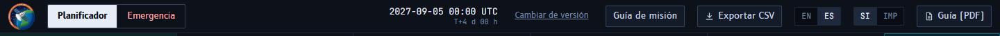

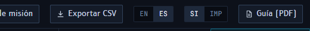

## 2. Planificador: la consola

El planificador es la vista de trabajo. Arriba está el veredicto; debajo, la vista 3D ocupa toda la pantalla y los paneles flotan sobre ella como bandejas de cristal que no la redimensionan. La cámara se recentra en el área libre para que el lander nunca quede tapado.

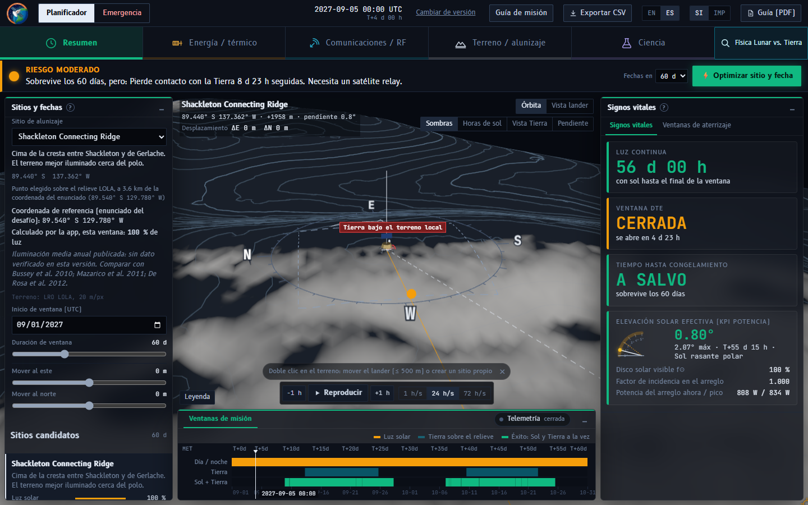

### 2.1 Veredicto

Una línea en lenguaje claro: **VIABLE**, **RIESGO MODERADO** o **CRÍTICO**, con la causa principal y el día en que ocurre. Si no está en verde, el botón **Optimizar sitio y fecha** prueba los 25 puntos de contacto a 200 m y luego las fechas siguientes (en 30, 60 o 90 días; 60 por defecto), y mueve el lander al primero que sobrevive. Muestra el antes y el después, cuántas misiones evaluó y el tiempo que tardó. Si nada salva la misión, lo dice.

### 2.2 Pestañas de subsistema

Cinco pestañas ocupan todo el ancho. Cada una trae sus paneles, su color y lo que destaca la escena 3D. Al cambiar de pestaña la interfaz pasa a negro, aparece el ícono del subsistema y vuelve la consola con su capa ya aplicada (alrededor de un segundo; con la opción del sistema «reducir movimiento» nada se mueve: solo fundidos).

| Pestaña | Color | Izquierda | Derecha | Abajo | Escena 3D |
|---|---|---|---|---|---|
| Resumen | esmeralda | Sitios y fechas | Signos vitales, Ventanas de aterrizaje | Ventanas de misión | Sombras |
| Energía / térmico | ámbar | Equipo: energía y térmico | Energía y supervivencia | Potencia y temperatura, Ventanas de misión | Horas de sol, haz solar |
| Comunicaciones / RF | cian | Equipo: radio y relays | Presupuesto de enlace | Horizonte 360°, Ventanas de misión | Vista de la Tierra, haz a la Tierra destacado |
| Terreno / alunizaje | gris claro | Actitud y vuelco | Dispersión y escape | Horizonte 360°, Ventanas de misión | Pendientes, flecha de escape |
| Ciencia | violeta | Sitios y fechas | Índice de aptitud, Vista de ingeniería | Línea de tiempo detallada | Sombras |

Cada bandeja tiene un **(?)** con una explicación de una frase y un botón **—** para minimizarla; la pestaña que queda en el borde la vuelve a abrir.

### 2.3 Vista 3D

* **Arrastrar** orbita la cámara; la **rueda** acerca y aleja.
* **Arrastrar el lander** lo mueve dentro del cuadro punteado de ±500 m. Cada posición es una misión nueva.
* **Doble clic en el terreno**: a ±500 m mueve el lander; más lejos crea un sitio propio. Al pasar el cursor, un retículo dice qué ocurrirá: «Mover el lander (X m)» o «Crear sitio propio aquí». Al norte de 80° S el retículo se pone rojo y el doble clic muestra «Fuera del área». La pista de abajo recuerda esto y se oculta con la **×** (queda recordado).
* **Órbita / Vista lander**: cámara exterior o desde el mástil del lander.
* **Sombras / Horas de sol / Vista Tierra / Pendiente**: capa de color sobre el terreno, con su escala.
* **Leyenda**: explica cada símbolo de la escena.
* Arriba a la izquierda: nombre completo del sitio, coordenadas, altura, pendiente y el desplazamiento del lander (ΔE, ΔN), con **Volver al punto nominal** cuando se movió.
* Los nombres de los accidentes del relieve flotan sobre el horizonte con su distancia.

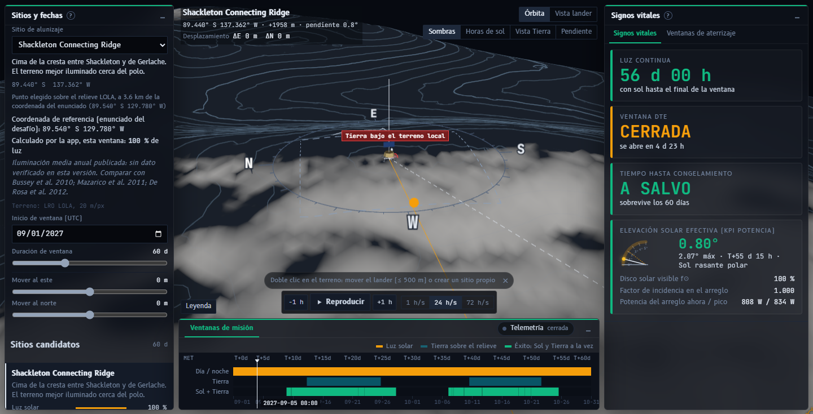

### 2.4 Control de tiempo (en la vista 3D)

Abajo al centro: **−1 h**, **Reproducir / Pausa**, **+1 h** y la velocidad: **1**, **24** o **72 h/s** (24 por defecto). Para saltar más lejos, arrastra sobre la línea de tiempo.

### 2.5 Telemetría

El chip **Telemetría** (abierta / cerrada, se recuerda entre visitas) muestra lo que reportaría el lander a la hora del reloj, en cuatro grupos:

* **Sol**: Sol visible (% del disco) y altura del Sol.
* **Energía**: potencia de los paneles y batería.
* **Térmico**: temperatura de la electrónica y calefactores.
* **Enlace con la Tierra**: Tierra sobre el relieve, estación terrena, margen de enlace (cuánto sobra de señal respecto al mínimo) y tasa de datos.

Verde, ámbar y rojo siguen umbrales definidos en un solo lugar: batería bajo 40 % y 20 %, electrónica bajo 0 °C y −20 °C, margen bajo 3 dB y 0 dB. Al pasar el cursor por una lectura aparece su explicación. En Ciencia se añaden las lecturas técnicas: acimut solar, despeje de línea de vista, pérdida extra y ángulos de la Tierra.

## 3. Paneles de Resumen

### 3.1 Sitios y fechas

Un solo escenario de alunizaje: **sitio** (cinco candidatos, dos alunizajes reales o coordenadas propias), **inicio de ventana** (UTC), **duración** (1–180 días) y el **desplazamiento** al este y al norte. Muestra la descripción del sitio, sus coordenadas, la distancia a la coordenada del enunciado y la fuente del terreno (LRO LOLA y su resolución). Los nombres de los sitios se muestran siempre completos.

### 3.2 Signos vitales

Tres tarjetas grandes contadas desde la hora del reloj: **luz continua** restante, **ventana DTE** abierta o cerrada (y cuándo cambia) y **tiempo hasta congelamiento**.

### 3.3 Ventanas de aterrizaje

Busca en 30, 60, 90 o 180 días qué fechas de contacto sirven para una misión de N días y un rumbo de aproximación. Una fecha se acepta si el lander toca la superficie con sol, la descarga cierra, sobrevive la misión y el Sol no queda de frente ni justo detrás de las cámaras de descenso. La franja de colores muestra cada fecha; la lista da las ventanas con **Alunizar ahí**; la tabla dice por qué se rechazan las demás. El cono de deslumbramiento (±25°), el cono sin sombras (±15°) y la elipse con al menos 50 % de sol son umbrales supuestos de ingeniería, fijos.

### 3.4 Comparar (dentro de Ventanas de aterrizaje)

El interruptor **Comparar con otro sitio o fecha** crea el escenario B como copia del actual. Aparecen:

* **En la vista 3D: A / B**, para elegir cuál se ve.
* Los controles del **escenario B** (sitio, fecha, ventana, desplazamiento) y el atajo **Usar la misma ventana que A**.
* El **comparador rápido**: cuatro barras por escenario (energía solar, contacto con la Tierra, supervivencia nocturna y seguridad de aterrizaje = 1 − P(vuelco)), con la pendiente aparte.
* La **tabla KPI** completa, con la marca del mejor valor de cada fila.

Al apagarlo, B desaparece de la vista 3D, de la línea de tiempo y de todas las tablas.

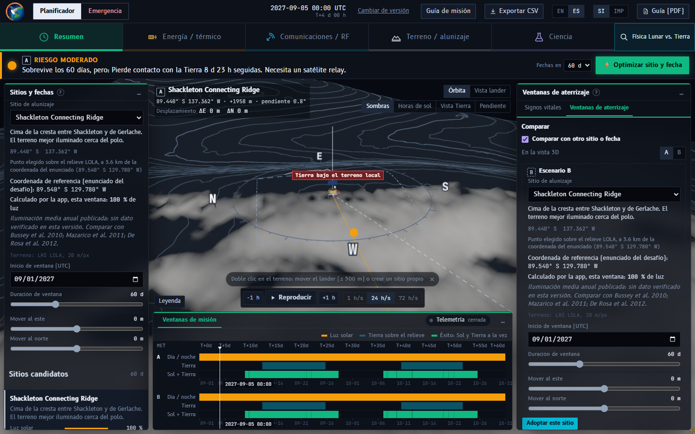

### 3.5 Ventanas de misión (línea de tiempo)

Cada fila es la ventana completa: día/noche, Tierra visible y ambos a la vez (las «ventanas de oro»). Arrastrar sobre ella mueve el cursor de tiempo.

## 4. Energía / térmico

* **Equipo**: altura de paneles y antena (2 m o mástil de 10 m), montura de paneles, área, eficiencia, consumo operativo y de supervivencia, batería y límite de descarga. **Control térmico**: acoplar la batería a la temperatura del bus, potencia de calefactores, área radiante, emisividad, masa térmica y sumidero en sombra. **Supuestos avanzados** (plegado): calefactores a 0 °C, pérdida de capacidad bajo −10 °C, congelamiento a −20 °C; supuesto de ingeniería.
* **Energía y supervivencia**: si sobrevive la ventana, temperatura mínima, horas y energía de calefactores, energía solar y pico, carga mínima, factor de vista al cielo y terreno circundante con sol. Avisa la muerte térmica crítica.
* **Potencia y temperatura**: potencia del panel (relleno ámbar), carga de batería y temperatura del bus en el tiempo.

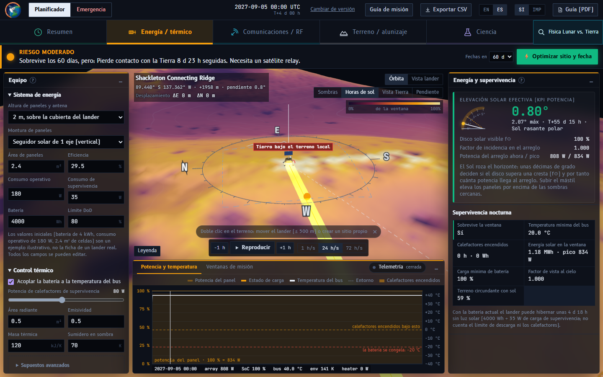

## 5. Comunicaciones / RF

* **Equipo**: enlace DTE (banda X o S, margen de antena, estación, potencia, antena del lander, ancho de banda, margen de enlace) y **satélites relay**: preset de órbita, número de satélites y tasa lander-relay.
* **Presupuesto de enlace**: ganancia, ancho de haz, PIRE, pérdida de espacio libre, G/T, C/N₀, tasa alcanzable, Eb/N₀ y margen. **Crestas entre el lander y la Tierra**: difracción sobre hasta tres crestas (Deygout). **¿Qué estación cierra el enlace?**: ingresa la tasa objetivo o usa los chips 10 / 100 / 1000 kbps; da el G/T y la antena equivalente que hacen falta.
* **Horizonte 360°**: el perfil del horizonte con las trayectorias del Sol y de la Tierra.

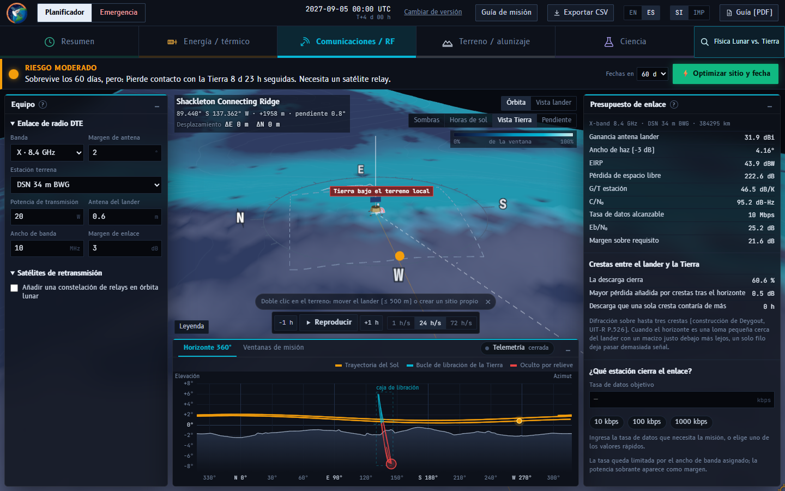

## 6. Terreno / alunizaje

* **Actitud y vuelco**: presets (nominal, IM-1, IM-2, SLIM, apoyado en la pendiente), alabeo, cabeceo, guiñada, ancho de haz y cardán de la antena, y sus penalizaciones. Probabilidad de vuelco sobre la elipse según la velocidad de contacto. **Reproducir un alunizaje real**: siempre advierte que el modelo no reproduce la pérdida de IM-2 Athena (quedó en un cráter pequeño en sombra que el terreno de 20 m no contiene). **Activo vecino**: radio de exclusión del penacho y sombreado mutuo.
* **Dispersión y escape**: la malla de 25 puntos de contacto a 200 m (cada celda es una misión completa), la mejor celda con su vector de escape y la incertidumbre del terreno LOLA. El flujo de emergencia está solo en el modo Emergencia (sección 10).

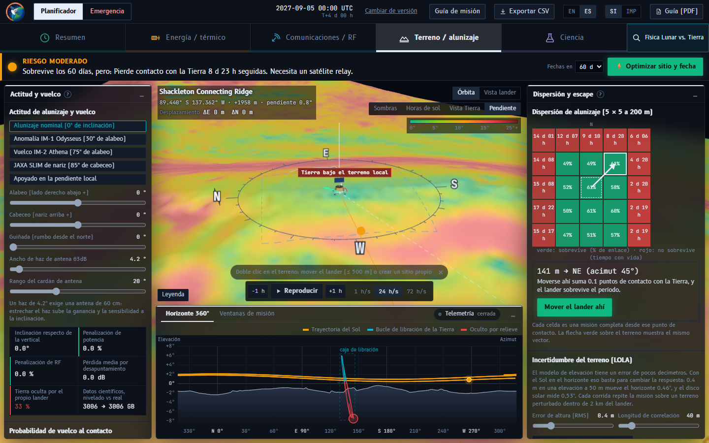

## 7. Ciencia

* **Índice de aptitud** de 0 a 100, sintetizado: luz, vista a la Tierra, pendiente y FeO, con el peso, la fuente y el rango de cada criterio (al pasar el cursor). Cada rango se ancla a un límite físico; la rugosidad, la proximidad a sombra permanente y la gravedad quedan fuera porque no tienen uno. Datos orbitales del sitio (temperaturas Diviner, hielo estable, PSR).
* **Vista de ingeniería**: la tabla completa de KPI y la **incertidumbre del terreno** (error de altura RMS, longitud de correlación, N variantes de terreno, probabilidad de sobrevivir y bandas P10/P50/P90) y la tabla **Supuestos del modelo**: cada parámetro, su valor, su unidad, su origen («fuente: …» o «supuesto del equipo») y dónde se usa. En esta consola la línea de tiempo es la **detallada**: Sol, batería, Tierra visible, descarga por estación, relay y operación simultánea.

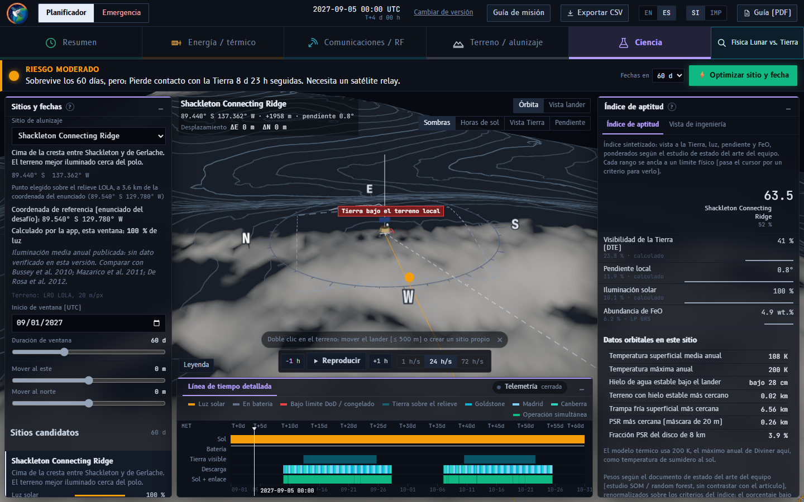

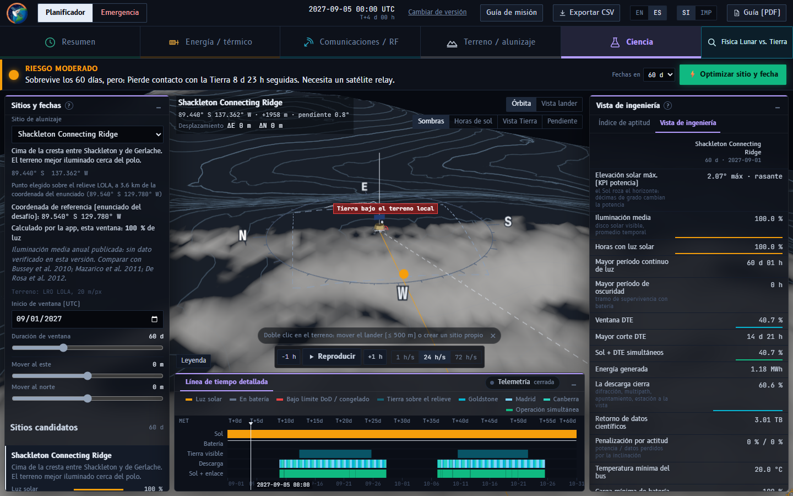

## 8. Modo tutorial (Guía de misión)

Un aviso explica que la aplicación cambiará de pestañas, sitio y fecha por sí sola. Con **Iniciar**, una secuencia fija de 10 pasos conduce la interfaz: vista 3D, doble clic, control de tiempo, las cinco pestañas, ventanas de aterrizaje y comparación, modo Emergencia y Exportar. Cada paso resalta el control del que habla. **Flecha derecha** avanza, **flecha izquierda** retrocede y **Esc** sale. Al salir o terminar, la aplicación vuelve exactamente a donde estabas. En la primera visita, una tarjeta abajo a la derecha ofrece el mismo recorrido u omitirlo.

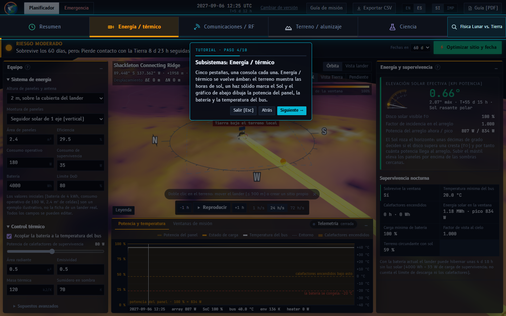

## 9. Fichas de sitios candidatos (público y docentes)

En Resumen > Sitios y fechas, debajo del escenario, una ficha por cada uno de los cinco sitios candidatos con tres medidores: luz solar y contacto con la Tierra (0–100 % de la ventana) y noche más larga (barra llena = lo que la batería resiste en hibernación). Un clic selecciona el sitio. El modo Explorador de la versión 2.0 se retiró: su recorrido lo cubre el modo tutorial y sus tarjetas de estado, los signos vitales.

## 10. Modo Emergencia

Para un lander que ya está en la superficie en un lugar no previsto. Pregunta solo lo esencial y evalúa desde **ahora** durante los próximos 15 días (una noche lunar; también 3 o 7):

1. **Posición actual**: clic en el mapa polar o coordenadas pegadas (por ejemplo −84,79; 29,20). Se acepta cualquier punto al sur de 80° S.
2. **Energía disponible**: Wh restantes en la batería y carga mínima de supervivencia.
3. **Inclinación actual** (opcional, plegada): alabeo, cabeceo o «Quedamos apoyados en la pendiente».

Responde primero con un titular en lenguaje llano: **SOBREVIVE**, **SOBREVIVE SI…** o **NO SOBREVIVE**, con fecha y hora (UTC y T+). Justo debajo, el bloque **Salida** dice si hay salida y da las opciones calculadas con el motor: quedarse y reducir la carga, moverse hasta 500 m y esperar la próxima luz; si ninguna alcanza, dice qué faltaría. El criterio de pérdida es el del motor: batería agotada sin sol o, con el modelo térmico, bus bajo −20 °C. Después vienen la fuente y resolución del terreno, el tiempo hasta congelarse y **hacia dónde moverse**: la malla de 25 puntos a 200 m (cada celda es una misión completa), el vector de escape y **Mover el lander ahí**. La flecha verde sobre el terreno es el mismo vector. Los peligros bajo el píxel de 20 m (LOLA + micro-relieve fractal: micro-sombras y rocas) se muestran siempre; son estadísticos, no un mapa.

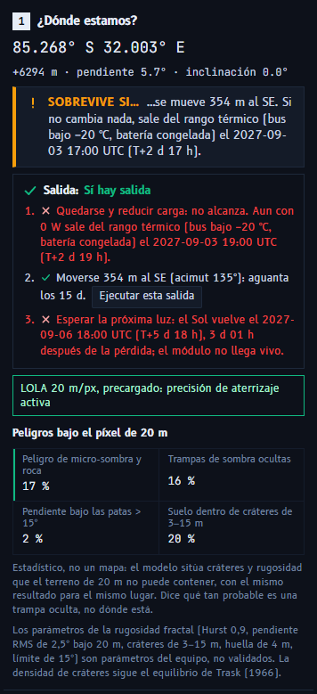

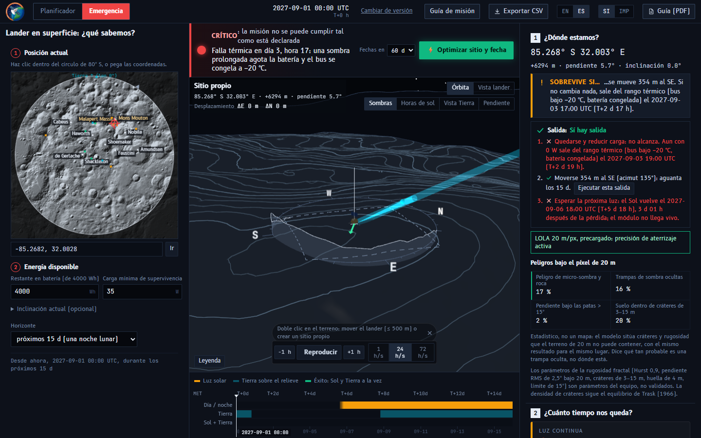

## 11. Usos según el usuario

**Ingeniero de misión.** Fija sitio y fecha en Resumen, dimensiona energía y térmica en Energía, comprueba el enlace en Comunicaciones, revisa actitud, vuelco y escape en Terreno y valida todo en Ciencia > Vista de ingeniería. Usa Ventanas de aterrizaje para elegir la fecha y Comparar para decidir entre dos sitios o dos fechas. Exporta el CSV para las herramientas de la estación terrena.

**Público y docentes.** El modo tutorial y las fichas de sitios cuentan la física del polo sur sin jerga: el Sol rasante, las sombras largas, la Tierra que se esconde tras las montañas y por qué unos cientos de metros cambian el destino de un lander.

**Equipo ante una emergencia.** El modo Emergencia responde en orden: dónde estamos, cuánto tiempo queda y hacia dónde movernos, desde ahora.

## 12. Fuentes y límites

* Terreno: LRO LOLA (Barker et al., 2023), 20 m/px cerca de los sitios; el resto del casquete a menor resolución.
* Efemérides: astronomy-engine. Estaciones: DSN (Goldstone, Madrid, Canberra).
* No se modelan la trayectoria de descenso, el combustible ni los errores de navegación. El vehículo por defecto es ilustrativo.
* La fórmula de Deygout y los parámetros del micro-relieve se escribieron sin contrastar con la norma o la literatura citada.

## 13. Entrega final v3.1: novedades

**Puerta de entrada y dos modos.** Al abrir la app se pregunta «¿Has usado esta app alguna vez?». *No* → **Comenzar entrenamiento (Modo Guiado)**, el modo Principiante: ocho misiones narradas que desbloquean los subsistemas uno a uno y entregan una insignia por misión. *Sí* → **Abrir Mission Leader (Modo Completo)**. En la barra superior, **Cambiar de versión** vuelve a la pregunta; el escenario, el idioma y las unidades se conservan.

**Unidades SI / Imperial.** Junto a ES / EN, en la puerta de entrada (**Unidades: SI (m, °C) | Imperial (ft, °F)**) y en la barra superior (**SI / IMP**). Cambian longitudes, distancias, temperaturas, velocidades y áreas en tarjetas, deslizadores, ejes, etiquetas 3-D y narración. Potencia (W), energía (Wh), frecuencia (GHz), tasas, dB y ángulos no cambian. Se recuerda entre visitas. El motor y el CSV trabajan siempre en SI (el CSV lo declara en su cabecera).

**Elevación solar efectiva (KPI de potencia).** En Signos vitales, en la tabla de KPI y en la cabecera de Energía / térmico: elevación del centro del disco solar ahora y máxima de la ventana, el disco visible f☉, el factor de incidencia sobre el arreglo y la potencia ahora / pico, sobre un arco de 0° a 5°. En el polo el Sol roza el horizonte: décimas de grado deciden si el disco supera una cresta.

**Telémetro del cursor.** Al pasar el cursor por el terreno 3-D se lee en vivo la distancia y el rumbo desde el lander, la elevación y la pendiente bajo el cursor, dentro y fuera del cuadro de ±500 m. Una línea punteada une el lander con el cursor. Fuera del cuadro el indicador se pone ámbar y dice que el doble clic crea un sitio propio.

**Aprender más: Física Lunar vs. Tierra.** Botón en cada celebración de misión y en el diploma del modo Principiante, y botón **Física Lunar vs. Tierra** en la barra de subsistemas del modo Completo. Abre una ventana con dos columnas (En la Tierra / En el Polo Sur lunar), un diagrama simple y cifras calculadas con el motor: cielo y Sol rasante, por qué 200 m lo cambian todo, frío radiativo, radio y libración, polvo balístico, trampas frías y un resumen maestro.

**Límites de los datos LOLA.** Un bloque en Terreno › Dispersión y escape, en el modo Emergencia y en la tabla de supuestos declara la resolución (20 m/px en los sitios, 160 m/px en coordenadas libres, 800 m/px para el horizonte lejano hasta 250 km), la interpolación entre trazas láser y el carácter estadístico del micro-relieve. Las corridas de incertidumbre propagan el error de altura a la luz, la vista de la Tierra y la supervivencia como bandas P10 / P50 / P90.

**Contraste con mapas publicados.** Cada sitio muestra la coordenada de referencia del enunciado y la luz calculada por la app junto a la iluminación anual publicada. Mientras un valor no se haya verificado contra el artículo (Mazarico et al. 2011, Bussey et al. 2010, De Rosa et al. 2012), la app dice «sin dato verificado» en vez de inventarlo.

**Optimizar sitio y fecha en segundo plano.** La búsqueda de rescate (25 puntos y fechas posteriores) corre en un Web Worker, con poda de puntos demasiado empinados para posarse, y no detiene la vista 3-D. El registro del resultado indica si corrió en el Worker.

**Sin conexión.** Todo el terreno, las capas científicas, las imágenes y las guías vienen en el repositorio; la app funciona sin internet.

## Glosario de Términos Lunares y de Ingeniería

Las mismas definiciones aparecen en la app como tooltips: pasa el cursor (o enfoca con el teclado) un término subrayado con puntos, sobre todo en la narración del modo Principiante.

**DTE (directo a la Tierra).** Enlace de radio del lander directo a una antena en la Tierra, sin satélite de relevo. Necesita la Tierra sobre el horizonte local y una estación terrena que vea la Luna.

**LOS (línea de visión / pérdida de señal).** Línea de visión: el camino recto entre la antena y el objetivo. Cuando el relieve la corta, se pierde la señal (también LOS, loss of signal).

**Libración lunar.** La Luna muestra siempre la misma cara a la Tierra, pero su órbita inclinada y elíptica la hace oscilar unos ±7,9° en longitud y ±6,7° en latitud. Desde la Luna, la Tierra se pasea dentro de una pequeña caja del cielo en vez de salir y ponerse.

**DEM (modelo digital de elevación).** Una grilla de alturas del suelo, un valor por celda (aquí 20 m por píxel cerca de los sitios). Todas las sombras, pendientes y horizontes de la app salen de ella.

**LOLA (altímetro láser del LRO).** Altímetro láser del Lunar Reconnaissance Orbiter de la NASA. Midió la altura de la superficie a lo largo de trazas orbitales; entre trazas los mapas polares se interpolan (Barker et al. 2023).

**PSR (región permanentemente sombreada).** Suelo en el fondo de cráteres polares al que el Sol nunca llega, porque cerca del polo no sube más de uno o dos grados sobre el horizonte. Las PSR son trampas frías donde el hielo de agua puede perdurar.

**WEH (hidrógeno equivalente a agua).** Hidrógeno medido desde órbita con espectrómetros de neutrones, expresado como si fuera todo hielo de agua (% en peso). Un indicio de hielo, no una detección directa.

**DoD (profundidad de descarga).** Cuánto de la capacidad de la batería se ha usado. Las descargas profundas acortan su vida, por eso las misiones fijan un límite seguro.

**Difracción de filo de cuchillo (Deygout / ITU-R P.526).** Las ondas de radio se doblan un poco sobre una cresta y pierden potencia. ITU-R P.526 da la pérdida de un filo agudo; el método de Deygout suma la cresta principal y las secundarias (aquí hasta tres).

**Primera zona de Fresnel.** El volumen en forma de cigarro alrededor de la línea de visión que lleva la mayor parte de la energía de radio. Su radio es √(λ·d1·d2/(d1+d2)); el relieve dentro de ella debilita el enlace aunque la línea de visión esté libre.

**Multipath en regolito.** Parte de la señal rebota en el suelo y llega con retraso, sumando o anulando la señal directa. Importa sobre todo con la Tierra baja, como en el polo. El regolito se modela con permitividad εr = 3,7.

**Actitud 6-DOF (alabeo, cabeceo, guiñada).** Un cuerpo tiene seis grados de libertad: tres posiciones y tres giros. La actitud son los tres giros: alabeo, cabeceo y guiñada. Un lander inclinado apunta mal sus paneles y su antena.

**Gimbal (cardán).** Montura articulada que deja girar la antena respecto del cuerpo del lander. Su rango (grados) dice cuánto puede alejarse del eje del cuerpo y aún apuntar a la Tierra.

**PSI (interacción pluma-superficie).** El chorro del motor de un lander al alunizar arrastra el regolito. Sin aire que lo frene, el polvo vuela en trayectorias balísticas rápidas y rasantes que pueden dañar equipos lejanos.

**ELFO (órbita lunar elíptica congelada).** Órbita muy alargada cuya forma se mantiene casi fija por años, con su punto lejano sobre el polo sur: un satélite de relevo ahí ve el polo muchas horas por órbita.

**Índice SOM-RF.** Puntaje multicriterio con que la app ordena los sitios (vista de la Tierra, luz, pendiente, rugosidad, hielo, etc.). Sus pesos vienen del documento de estado del arte del equipo, que cita un estudio de mapas autoorganizados y bosques aleatorios; no se han contrastado con ese artículo.
